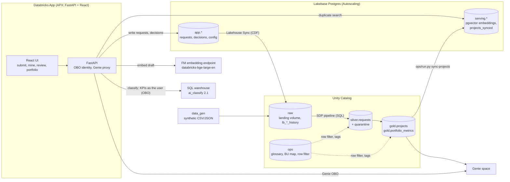

# AI Task Force intake

An intake app where business units at the carrier propose AI, data, and analytics projects. While the requester types, the app flags likely duplicates of existing work. Each new request is classified on submit, and the Task Force reviews, approves, or merges requests. The portfolio is queryable in Genie. All data is synthetic.

## Business case

The synthetic log is the baseline: an asset-light carrier whose ideas come from an agent network and capacity teams, triaged by hand. `data_gen/shape.py` gives it freight seasonality (produce season and Q4 peak) and business-unit skew, and the metric view reports what the CFO, who funds the AI portfolio, is measured on.

| KPI (metric view measure) | Baseline (shaped log) | Target | Supported by |
|---|---|---|---|
| Time to catch a duplicate | 34 days (found at review) | < 5 s (while typing) | deployed demo: flagged 3.6 s after typing |
| Duplicated value reaching funding (`duplicate_value_usd`) | $6.4M (10% of requests) | < $1.3M (−80%) | 0.70 band surfaces 17/18 planted pairs |
| Median submit-to-decision (`median_cycle_days`) | 34 days (36 in peak season) | ≤ 10 days | pre-categorized, one-click review |
| Backlog value (`open_value_usd`) | $39.7M | −50% | faster decisions, merges at intake |

Targets are projections (A61). Capacity, agent operations, and brokerage file 48% of requests and 57% of their value.

## Architecture



## Repo map

| Path | What it holds |
|------|---------------|
| `config/` | Form fields, categories, thresholds (packaged into the app) |
| `data_gen/` | Seeded synthetic data; names come from `names.py` |
| `pipeline/` | SDP SQL: bronze, silver (expectations, `ai_extract`, `ai_classify`), gold (embeddings, clusters) |
| `governance/uc_setup.sql` | Schemas, comments, tags, row filter |
| `governance/metric_view.sql` | `gold.portfolio_metrics` metric view (CFO KPIs and the peak-season dimension) |
| `lakebase/setup.sql` | Postgres schema, pgvector, app grants |
| `src/oneintake/` | APX app: `backend/` (FastAPI, sqlmodel) and `ui/` (React, shadcn, orval) |
| `ml/` | Classifier evaluation and duplicate-threshold tuning (MLflow) |
| `genie/` | Genie space creation, config, answer check |
| `ops/` | Runner used locally and by jobs |
| `tests/` | Data, governance, API, and Playwright demo-flow checks |
| `evidence/` | Output of every pipeline, check, and evaluation |

## Setup

Requirements: `uv`, `bun`, the Databricks CLI, and a workspace with Lakebase Autoscaling, a SQL warehouse, and FM endpoints.

1. Create `.env` (gitignored) with `DATABRICKS_CONFIG_PROFILE`, `DATABRICKS_SQL_WAREHOUSE_ID`, `INTAKE_CATALOG`, `LAKEBASE_PROJECT`, and `LAKEBASE_BRANCH`. Then load it: `set -a; source .env; set +a`.
2. Set the target's `catalog` variable in `databricks.yml`, then build and deploy:
   ```bash
   uv run apx build
   databricks bundle deploy --profile <profile>
   ```
3. Load data and governance: `databricks bundle run data_setup`. This generates and uploads data, sets up Lakebase and grants, starts Lakehouse Sync, refreshes the pipeline, applies governance and the metric view, and syncs projects.
4. Create the Genie space with `uv run python genie/genie_space.py`. Put the printed id in the target's `genie_space_id` variable and deploy again.
5. Start the app: `databricks bundle run oneintake_app`.
6. Evaluate: `databricks bundle run evaluation` runs the classifier eval, threshold tuning, and Genie answer check.

Local development: `uv run apx dev start` serves the app at `http://127.0.0.1:9002`, using the OBO emulator with your CLI identity.

## Checks

```bash
uv run pytest tests/test_data_gen.py tests/test_api.py      # data rules, live API, latency
uv run pytest tests/test_governance.py                      # comments, tags, row filter as member and non-member
uv run pytest tests/test_demo_flow.py                       # browser demo flow (DEMO_BASE_URL for the deployed app)
uv run python ml/evaluate_classifier.py
uv run python ml/tune_duplicate_threshold.py
```

Decisions are in `ASSUMPTIONS.md` and `DECISIONS.md`. Results are in `BUILD_REPORT.md`.
